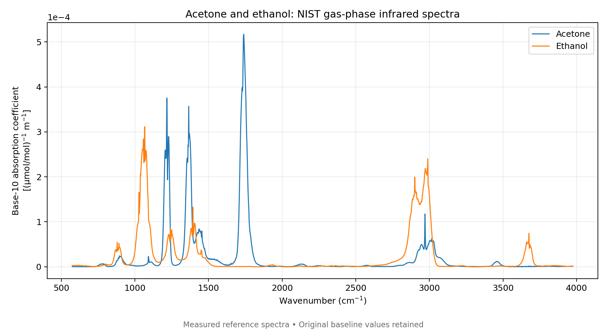
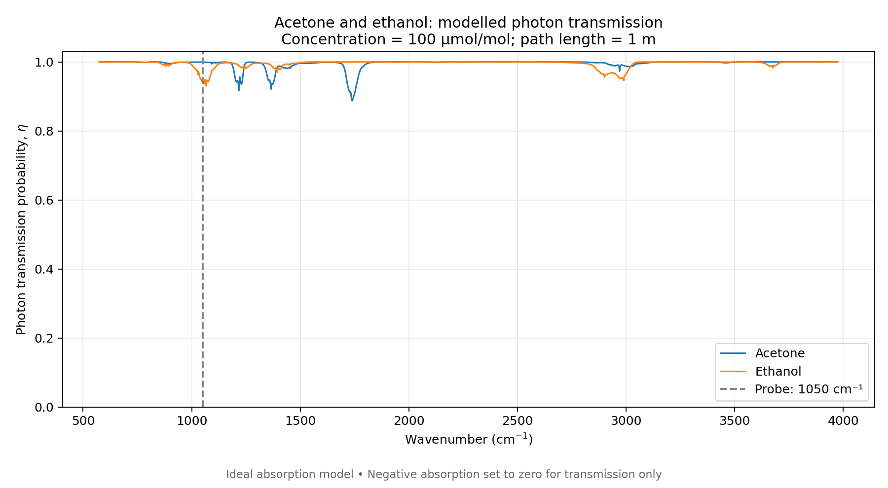
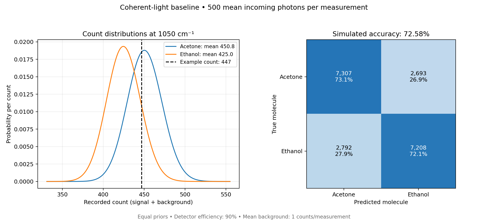
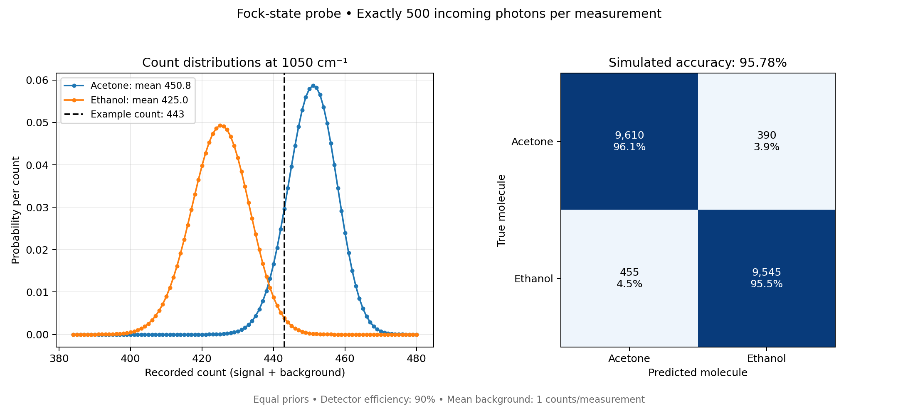
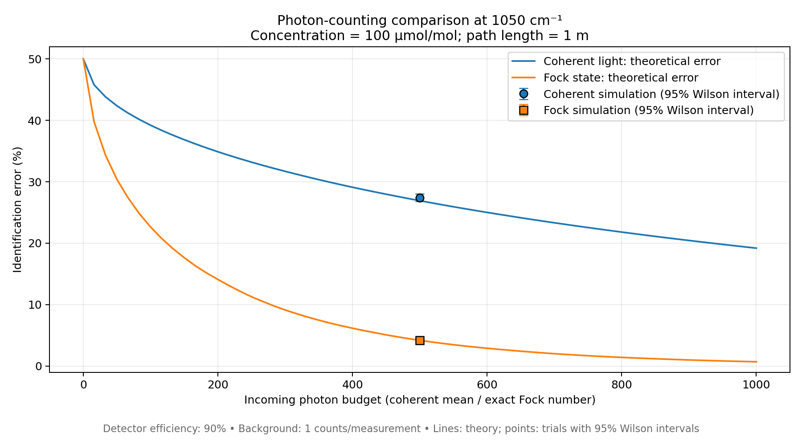
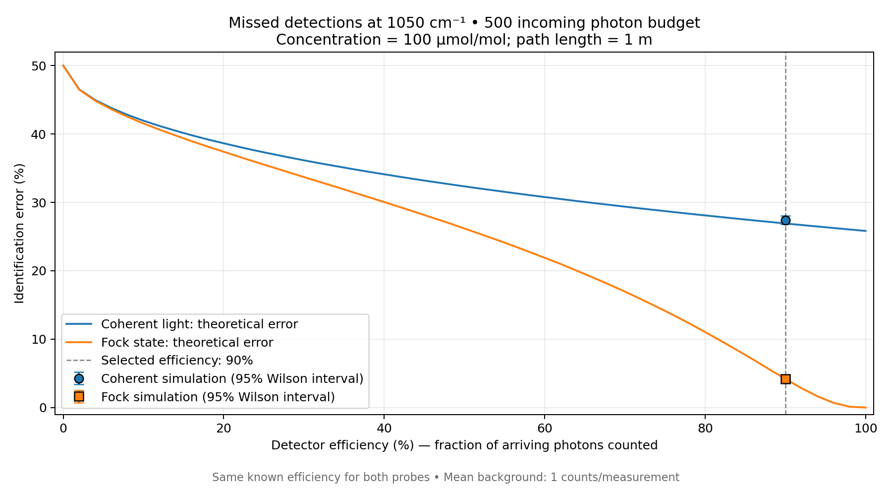
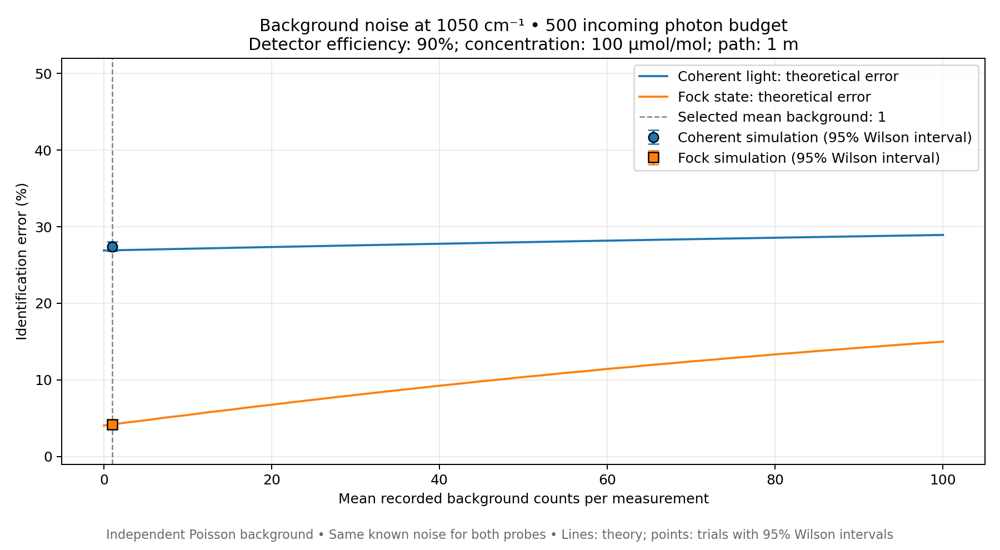
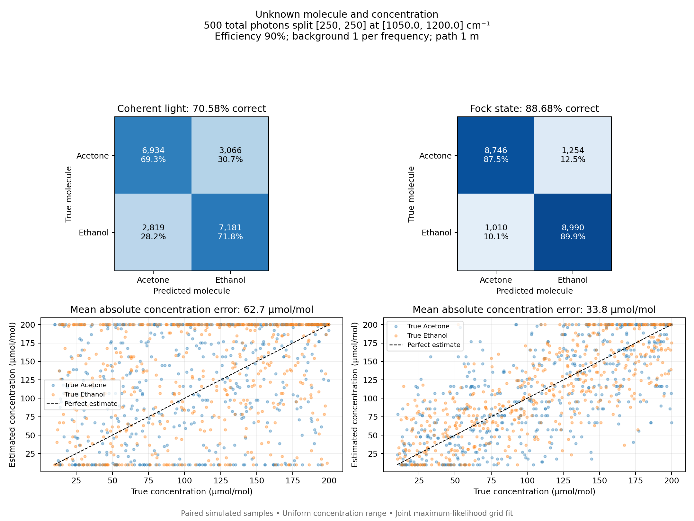
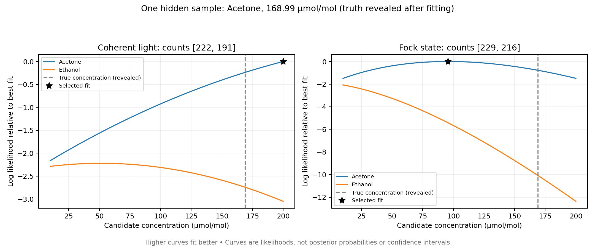

# Molecule identification — simulation report

Seed 42 · 10,000 trials per molecule · Detector efficiency 90% · Background 1 recorded counts per frequency · Path length 1 m

## Project brief — coherent and Fock relative entropy

Generic H0/H1 absorption hypotheses; perfect detection and zero background. D(P0 || P1) uses natural logarithms (nats). Independent measurements give total entropy mD. Evidence is accumulated for one unchanged H0 sample; positive values favour H0. Coherent counts are Poisson; Fock counts are binomial, at the same incident budget (mean for coherent, exact for Fock). Higher relative entropy means more expected information per measurement in this direction, not an accuracy percentage. Amplitude magnitudes apply only to coherent light; phase is unchanged.

| Quantity | Value |
| --- | --- |
| Transmissivities (H0, H1) | [0.95, 0.85] |
| Mean detected counts (H0, H1) | [475.0, 425.0] |
| Coherent relative entropy (nats) | 2.83218 |
| Fock relative entropy (nats) | 25.3669 |
| Input amplitude magnitude | 22.3607 |
| Output amplitude magnitudes (H0, H1) | [21.79449471770337, 20.615528128088304] |

## Known concentration — single frequency

Concentration 100 µmol/mol is supplied to the classifier. Probe frequency: 1050 cm⁻¹. Photon budget: 500 per measurement.

| Probe | Simulated accuracy | Simulated error | Theoretical error |
| --- | --- | --- | --- |
| Coherent light | 72.58% | 27.43% | 26.92% |
| Fock state | 95.78% | 4.23% | 4.19% |

## Unknown molecule and concentration — multiple frequencies

The classifier fits both identity and concentration. Frequencies: [1050.0, 1200.0] cm⁻¹; total photon budget 500 split as [250, 250]. True concentrations are drawn uniformly over [10.0, 200.0] µmol/mol.

| Probe | Identity accuracy | Concentration MAE (µmol/mol) | Boundary fits | Unidentifiable concentration |
| --- | --- | --- | --- | --- |
| Coherent light | 70.58% | 62.70 | 44.16% | 0.00% |
| Fock state | 88.68% | 33.77 | 18.08% | 0.00% |

## One hidden-sample example

Truth is revealed after fitting. An example can be worse than average.

| Probe | Recorded counts | Predicted molecule | Estimated concentration | True molecule | True concentration | Fit flags |
| --- | --- | --- | --- | --- | --- | --- |
| Coherent light | [222, 191] | Acetone | 200.00 | Acetone | 168.99 | Concentration at range boundary |
| Fock state | [229, 216] | Acetone | 95.50 | Acetone | 168.99 | None |

## How to interpret this run

- The brief baseline uses generic transmissivities, not molecular reference spectra. It always uses perfect detection and zero background; header detector settings apply to molecule experiments when present.
- These are simulated acetone-versus-ethanol samples, not independent laboratory measurements.
- Coherent photon budgets are means; Fock budgets are exact incident numbers. Source preparation is ideal.
- Detector efficiency, background and path length are known to the classifier. Concentration is hidden only in the unknown experiment.
- Concentration MAE includes wrong-molecule fits and excludes unidentifiable estimates. Boundary fits are constrained by the search range.
- Finite-trial accuracy can fluctuate. Zero observed mistakes do not establish zero theoretical error.
- Known- and unknown-concentration experiments differ in frequencies, sample concentrations and total background exposure; compare probes within each experiment.

## Graphs

Coherent (Poisson) versus Fock (binomial) counts and relative entropy at the same incident budget. Expected evidence is shown for both probes; simulated evidence traces are coherent only. Perfect detection and zero background apply regardless of extension settings.

Measured absorption reference spectra; taller peaks mean stronger absorption.

Sample transmission before detector losses; the dashed line marks the single-frequency probe.

Coherent-light recorded counts and decisions for the known-concentration experiment.

Fixed-photon-number recorded counts and decisions for the known-concentration experiment.

Known-concentration error versus photon budget. Lines are model predictions; points are simulated trials with 95% Wilson intervals.

Known-concentration error versus detector efficiency, at the selected background level. Points: simulated trials with 95% Wilson intervals.

Known-concentration error versus recorded background noise, at fixed signal settings. Points: simulated trials with 95% Wilson intervals.

Unknown-concentration decisions and estimates. The scatter shows a subset; metrics use all trials.

One hidden sample: higher likelihoods fit better. The star selects a fit; the dashed line reveals the truth. These are not confidence probabilities.

Full settings, example counts, confusion matrices, versions and file hashes are saved in [results.json](results.json).
